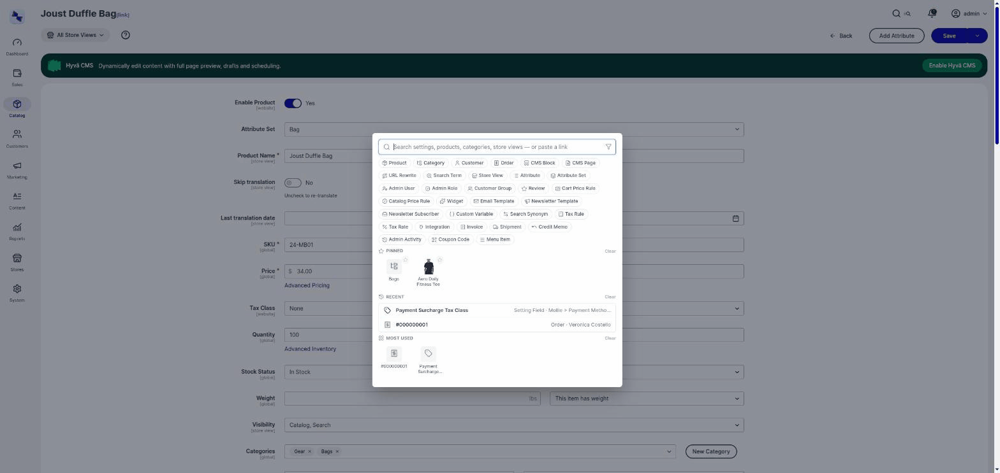

#  QuickNav

**Fast, ACL-aware admin search for Magento.** Type a few characters to jump straight to
products, categories, configuration, customers, orders, CMS pages/blocks, URL rewrites, store
views, admin users/roles, price rules, and more — or paste a storefront link to land on the
matching admin record instead of hunting for it. Ships as a
[Hyvä Admin Dashboard](https://docs.hyva.io/) widget, with type filters, full keyboard
navigation, and per-admin pinning/recents/most-used personalization.



## Why QuickNav

- **Everywhere, instantly.** Press `Ctrl+K` / `Cmd+K` from any admin page — editing a product,
  writing a CMS page, buried in configuration, anywhere — to jump straight to where you actually
  want to go, without navigating back through menus first.
- **One search box, every entity type.** No more remembering which grid a setting, a CMS block,
  or a customer group lives under.
- **ACL-aware.** An admin only ever sees type filters and results for what their role can
  actually access — QuickNav never becomes a way to discover the existence of records a role
  can't see.
- **Keyboard-first.** Arrow keys move real focus through results (not just a visual highlight),
  Enter activates, Escape backs out — see the [user guide](docs/USER_GUIDE.md#keyboard-navigation)
  for the exact behavior.
- **Personal, not shared.** Pinned items, recents, and most-used are stored per admin account in
  the browser, never on the server.

## Requirements

- Magento Open Source or Adobe Commerce 2.4.4+ (verified against 2.4.9)
- Hyvä Commerce (paid), specifically:
  - `hyva-themes/magento2-theme-module`
  - `hyva-themes/commerce-module-admin-dashboard-api`
  - `hyva-themes/commerce-module-admin-dashboard`
  - `hyva-themes/commerce-theme-adminhtml`
  - `hyva-themes/magento2-default-theme`

Exact version constraints are in [`composer.json`](composer.json); composer resolves them.

## Documentation

- **[User guide](docs/USER_GUIDE.md)** — a full walkthrough of every feature, with screenshots:
  searching, type filters, keyboard navigation, personalization, result actions (pin / edit /
  view products / view on storefront / choose scope), query limiters, pasting a storefront link,
  [whole-page search](docs/USER_GUIDE.md#whole-page-search), the global Ctrl+K overlay, and
  [every admin setting](docs/USER_GUIDE.md#admin-settings).
- **[Icon legend](docs/ICONS.md)** — what every icon in the widget means, entity type by entity
  type.

## Installation

```
composer config repositories.bigbridge-quicknav vcs https://github.com/bigbridge-nl/quicknav.git
composer require bigbridge/quicknav
```

That resolves the latest released tag. Pin a version with `bigbridge/quicknav:^1.0` if you would
rather control upgrades yourself.

The global `Ctrl+K` / `Cmd+K` overlay described in the
[user guide](docs/USER_GUIDE.md#global-ctrlk--cmdk-overlay) ships built into this module — it's
on by default and can be turned off under **Stores > Configuration > Advanced > Quick Access
QuickNav**, so QuickNav is reachable from any admin page, not just the dashboard.

## Admin settings

QuickNav's own settings live under **Stores > Configuration > BigBridge > QuickNav Search
Index** (whole-page-search highlighting default, OpenSearch candidate narrowing) and
**Stores > Configuration > Advanced > Quick Access QuickNav** (the global overlay). Every admin
can also override the highlighting default for themselves on their own **Account Information**
page. Field-by-field details: [user guide → Admin settings](docs/USER_GUIDE.md#admin-settings).

Typing anywhere on an admin page — outside an input or QuickNav's own search box — can also
highlight matching visible page elements live, without opening QuickNav at all. See
[user guide → Whole-page search](docs/USER_GUIDE.md#whole-page-search) for the full behavior.

## License

Licensed under the [MIT License](LICENSE.txt).

## About BigBridge

QuickNav is built and maintained by [BigBridge](https://www.bigbridge.nl), a Magento agency
based in the Netherlands. Questions or issues? Open one on this repository.
