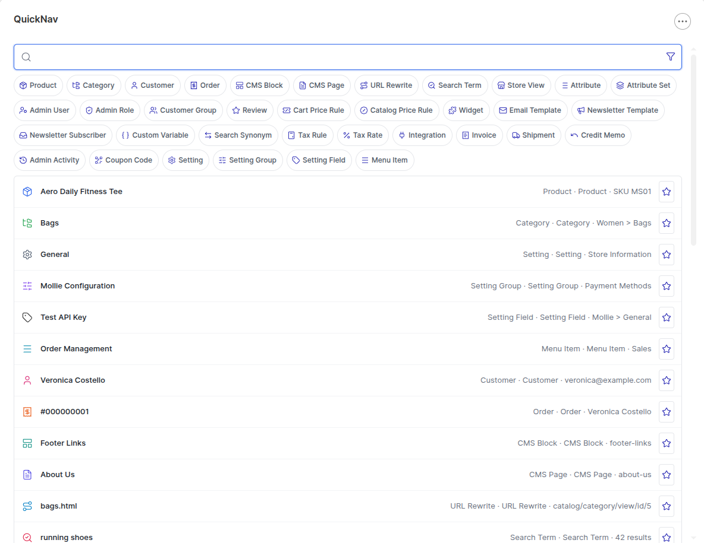
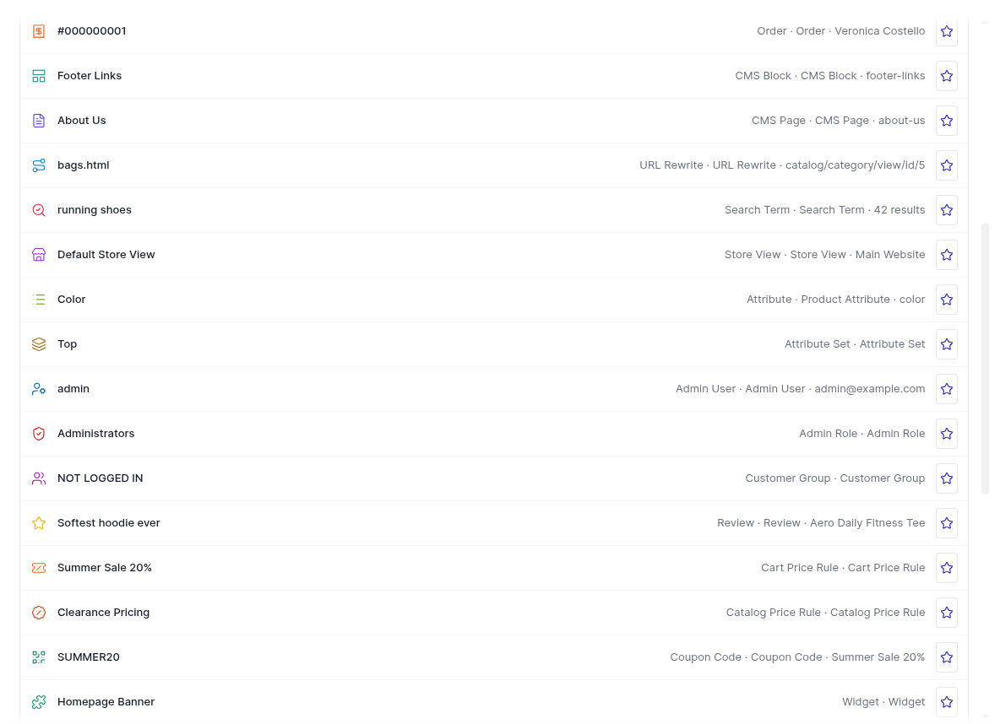
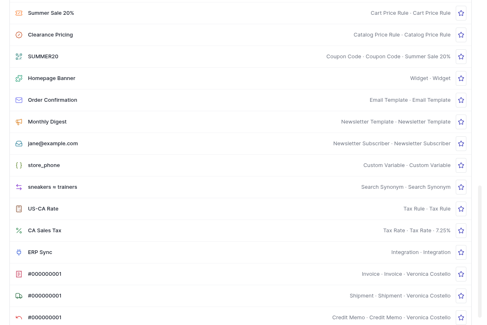
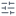

# Icon legend

Every QuickNav result carries a small leading icon that tells you, at a glance, what kind of
record you're looking at — before you even read the label. Products get a real thumbnail instead
of an icon whenever one is available; everything else uses one of the [Lucide](https://lucide.dev)
icons below, colored per type so the same shape always means the same thing throughout the widget
(the live results list, the personalization tiles, and the type-filter chips all share this exact
mapping).

Three screenshots below show one example row per type, so you can match a shape you're looking at
directly against its meaning.

## Full reference table

| Icon | Icon (Lucide name) | Entity type | What it means |
|---|---|---|---|
|  | `package` | Product | A catalog product |
|  | `folder-tree` | Category | A catalog category |
|  | `settings` | Setting | A `system.xml` configuration **section** |
|  | `sliders-horizontal` | Setting Group | A configuration **group** inside a section |
|  | `tag` | Setting Field | A single configuration **field** |
|  | `menu` | Menu Item | An admin menu entry (matched by its own label, so you can jump straight to a menu item without knowing which module owns it) |
|  | `user` | Customer | A customer account |
|  | `receipt` | Order | A sales order |
|  | `layout-panel-top` | CMS Block | A CMS static block |
|  | `file-text` | CMS Page | A CMS page |
|  | `route` | URL Rewrite | A storefront URL rewrite |
|  | `search-check` | Search Term | A logged storefront search term |
|  | `store` | Store View | A store view / website / store group |
|  | `list` | Product Attribute | A product attribute |
|  | `layers` | Attribute Set | A product attribute set |
|  | `user-cog` | Admin User | An admin user account |
|  | `shield-check` | Admin Role | An admin role (ACL resource set) |
|  | `users` | Customer Group | A customer group |
|  | `star` | Review | A product review |
|  | `ticket-percent` | Cart Price Rule | A cart price rule (including its coupon codes as a distinct sub-type, below) |
|  | `badge-percent` | Catalog Price Rule | A catalog price rule |
|  | `qr-code` | Coupon Code | A specific coupon code belonging to a cart price rule |
|  | `puzzle` | Widget | A CMS widget instance |
|  | `mail` | Email Template | A transactional email template |
|  | `megaphone` | Newsletter Template | A newsletter template |
|  | `inbox` | Newsletter Subscriber | A newsletter subscriber |
|  | `braces` | Custom Variable | A custom variable |
|  | `arrow-left-right` | Search Synonym | A search synonym group |
|  | `calculator` | Tax Rule | A tax rule |
|  | `percent` | Tax Rate | A tax rate |
|  | `plug` | Integration | An API integration |
|  | `receipt-text` | Invoice | A sales invoice |
|  | `truck` | Shipment | A sales shipment |
|  | `undo` | Credit Memo | A credit memo |
|  | `history` | Admin Activity | An admin activity log entry |
|  | `link` | *(fallback)* | Used only if a result somehow has no type-specific icon — should not normally appear |

## Result-row action icons

Beyond the leading type icon, each row can show up to four small action icons on the right,
depending on what that result type supports — numbered here to match the screenshot below:

| # | Icon | Action | Shown for |
|---|---|---|---|
| 1 |  star | Pin or unpin | Every result type |
| 2 |  pencil | Edit | Types with a direct admin edit page |
| 3 |  grid | View products | Categories only — jumps to the category's product grid instead of its edit page |
| 4 |  external link | View on storefront | Products, categories, and CMS pages that are actually visible on the storefront |
| — |  globe | Choose scope | Store-scoped settings with more than one configured value across scopes (replaces the pencil, not shown in the screenshot above) |

Picking an entry from the scope picker (🌐) navigates straight to that field's admin edit page
already switched to the chosen scope (default / website / store view) — it lands you directly on
the store-view-specific override, not the default value. The storefront picker (↗) is unrelated:
it opens the *public* storefront page for the record, not an admin edit page.

See [`docs/USER_GUIDE.md`](USER_GUIDE.md) for what each of these actually does when clicked.
