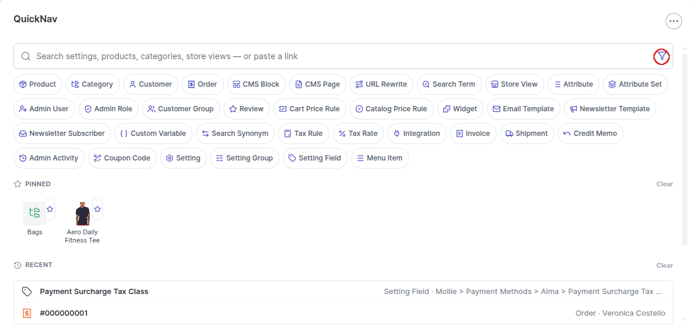
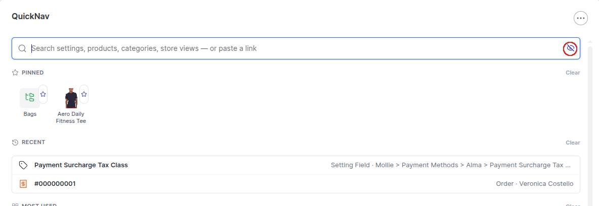
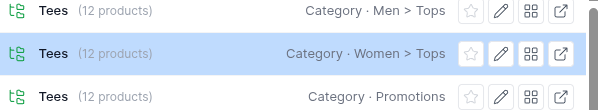
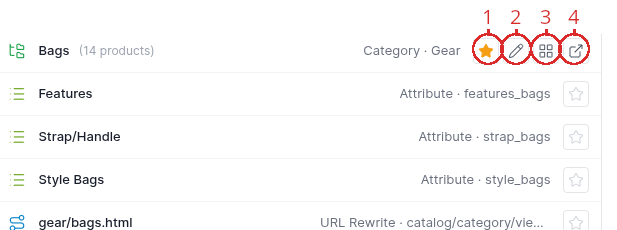
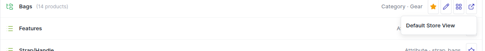
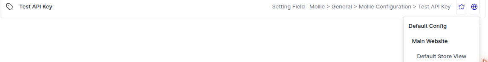
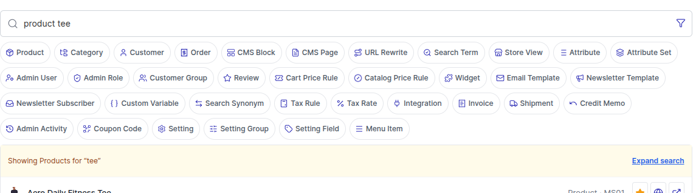
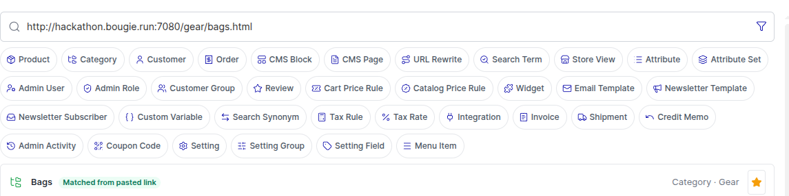
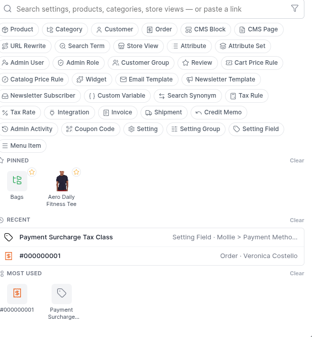

# QuickNav user guide

A complete walkthrough of every QuickNav feature, with screenshots. For a quick visual reference
of what each icon means, see [`docs/ICONS.md`](ICONS.md) instead.

## Contents

- [Where to find it](#where-to-find-it)
- [Searching](#searching)
- [Type filters](#type-filters)
- [Keyboard navigation](#keyboard-navigation)
- [Personalization: pinned, recent, and most used](#personalization-pinned-recent-and-most-used)
- [Result actions](#result-actions)
- [Query limiters](#query-limiters)
- [Paste a storefront link](#paste-a-storefront-link)
- [Whole-page search](#whole-page-search)
- [Global Ctrl+K / Cmd+K overlay](#global-ctrlk--cmdk-overlay)
- [Admin settings](#admin-settings)

## Where to find it

QuickNav ships as a [Hyvä Admin Dashboard](https://docs.hyva.io/) widget. Add it to your admin
dashboard via **Add Widget → QuickNav**, or — since the global overlay is built in and enabled by
default — press **Ctrl+K** (**Cmd+K** on macOS) from anywhere in the admin to open it as a global
overlay instead, without needing the dashboard widget at all.

## Searching

Type a few characters and results appear as you type (debounced, so it doesn't refetch on every
single keystroke). QuickNav searches across products, categories, configuration, customers,
orders, CMS pages/blocks, URL rewrites, store views, admin users/roles, price rules, coupon codes,
and more — see the full list in [`docs/ICONS.md`](ICONS.md).

Every result shows a breadcrumb-style context line so you know exactly where it lives (e.g. a
configuration field shows its section and group; an order shows the customer name it belongs to).

## Type filters

The row of chips below the search box narrows results to one or more specific types — click
**Product**, then **Category**, to see only products and categories, regardless of what you've
typed. Only chips for types your admin role can actually access at least one result of are shown,
so the row is never cluttered with permissions you don't have.

If you'd rather not see the chip row at all, click the funnel icon inside the search box (next to
the input, on the right) to hide it — it collapses without adding or removing a row, and your
choice is remembered the next time you open QuickNav. Click the icon again (now showing an
eye-off) to bring the chips back.

## Keyboard navigation

QuickNav is fully usable without a mouse:

- **↓** moves down through the results, starting from the first one.
- **↑** moves up — pressed from the search box with nothing highlighted yet, it jumps straight to
  the *last* result, so you can reach the bottom of a short list in one keystroke.
- Reaching either end and pressing further in the same direction returns focus to the search box
  rather than wrapping around the list, so you always know where you are.
- **Enter** activates whichever result currently has focus.
- **Escape** returns focus to the search box from a result, or clears the current search if
  pressed while already in the search box (pressing it again then closes the global overlay, if
  you opened QuickNav that way).

The currently-focused result is highlighted clearly, with a colored left edge, so it's never
ambiguous which one Enter will activate:

Hovering a result with the mouse highlights it too (in a lighter shade, to distinguish "the mouse
is here" from "this is what Enter will activate"), and clicking it activates it the same way Enter
does.

## Personalization: pinned, recent, and most used

Before you've typed anything, QuickNav shows three personalized lists instead of an empty box:

- **Pinned** — results you've explicitly starred, always shown first, in the order you pinned
  them.
- **Recent** — the last few results you actually opened.
- **Most used** — the results you open the most often, regardless of when you last opened them.

These are stored locally in your browser (`localStorage`), scoped to your own admin account, so
two admins sharing a browser profile never see each other's lists, and nothing is sent to or
stored on the server.

## Result actions

Depending on what a result actually supports, up to four action icons appear on the right of its
row (numbered below to match the screenshot):

1.  **Star** — pin or unpin the result.
2.  **Pencil** — edit the record directly.
3.  **Grid** — for categories only, jump straight to that category's product grid
   instead of its edit page.
4.  **External-link arrow** — view on the storefront, for anything
   actually visible there (products, categories, CMS pages). If more than one store view can show
   the record, this opens a small picker instead of navigating immediately.

A fifth icon, the  **globe**, appears in place of the pencil for configuration
values set differently across scopes — it lets you pick exactly which scope (default / website /
store view) to jump to, instead of always landing on the default one (see the scope-picker
screenshot further down).

The storefront picker ( **external-link arrow** icon) and the scope
picker ( **globe** icon) both open as a small dropdown anchored to the row — the
icon itself is the only visual difference between the two, since neither dropdown is labeled:

Picking an entry from the **scope picker** doesn't just filter or preview anything — it navigates
straight to that field's admin edit page *already switched to the scope you picked* (default,
a specific website, or a specific store view), so you land directly on the store-view-specific
override instead of the default value, with no extra scope-switcher clicks once you're there.

## Query limiters

Typing a recognized keyword ahead of your search text narrows the search to just that type —
for example, `product tee` searches only products for "tee", even if "tee" would otherwise also
match a CMS page or a customer group. QuickNav shows a banner confirming the narrowed scope, with
a one-click **Expand search** link to re-run the same text across every type if the limiter wasn't
what you wanted.

Recognized keywords include (among others) `product`, `category`, `customer`, `order`, `setting`,
`store`, `block`, `page`, `attribute`, `role`, `user`, `coupon`, `widget`, `tax`, and their plurals
— type a keyword on its own to see the full set of type-filter chips update as a hint.

## Paste a storefront link

Copied a link from the storefront and want the matching admin record instead of hunting for it?
Paste the full URL straight into the QuickNav search box. If it resolves to a product, category,
CMS page, or other record QuickNav knows about, that record appears immediately, badged so it's
clear it came from a pasted link rather than a text match.

## Whole-page search

With **Highlight page items while typing** enabled (see [Admin settings](#admin-settings) below),
typing anywhere on an admin page — outside of an input, textarea, select, or other editable field,
and outside QuickNav's own search box — starts a PhpStorm-style page search, without opening
QuickNav at all:

- Each keystroke narrows the search live: every visible element on the page (links, buttons,
  labels, list items, headings, table cells, and similar) whose text contains all the typed words,
  in order, gets outlined, with the matching words themselves wrapped in a highlight.
- **↓** / **↑** cycle through the matches, scrolling each one into view as it becomes active.
- **Backspace** removes the last typed character; **Escape**, or clicking anywhere on the page,
  clears the search and every highlight.
- It only ever searches elements already visible on the current page — it never fetches or
  reveals anything a click wouldn't already show.

Turning the setting off (admin-wide, or per admin) narrows this the other way: typing while
QuickNav's own widget or the global overlay has focus still highlights within that dialog, but
no longer reaches the rest of the page.

## Global Ctrl+K / Cmd+K overlay

This is built in and enabled by default: press **Ctrl+K** (**Cmd+K** on macOS) from any admin page
to open QuickNav as a centered overlay — no dashboard widget required. It's the exact same search
experience described above, just available everywhere instead of only on your dashboard. It can be
turned off under **Stores > Configuration > Advanced > Quick Access QuickNav**.

## Admin settings

All of QuickNav's own settings live under **Stores > Configuration > BigBridge > QuickNav Search
Index**, in two groups:

- **General**
  - **Highlight page items while typing** — the account-wide default for
    [whole-page search](#whole-page-search). Every admin can override this for themselves, see
    below.
- **OpenSearch Candidate Narrowing** — entirely optional; with it off, QuickNav searches the
  database directly, exactly as if it were never installed.
  - **Enable OpenSearch Narrowing** — turns candidate narrowing on. When enabled, QuickNav
    maintains its own OpenSearch index and uses it to narrow product/customer/order/coupon-code
    searches to candidate IDs before the database scan, which matters mainly on large catalogs.
    If the index or server is ever unreachable, QuickNav falls back to the plain database scan
    automatically — this setting is never a hard dependency.
  - **Connection** — a dropdown: **Custom** (the fields below) or **Use Magento's configured
    OpenSearch/Elasticsearch**, which reads the host and port straight from **Stores >
    Configuration > Catalog > Catalog Search > OpenSearch** and hides Host/Port/Scheme, leaving
    only the index prefix.
  - **Host**, **Port**, **Scheme** — only shown with Connection set to Custom. Defaults:
    `127.0.0.1`, `9200`, `http`.
  - **Index Name Prefix** — always shown when narrowing is enabled, regardless of which
    connection mode is chosen; QuickNav always writes to its own index, only named by this
    prefix. Default: `bigbridge_quicknav`.

A separate section, **Stores > Configuration > Advanced > Quick Access QuickNav**, has one
setting:

- **Enable Quick Access QuickNav** — the [global overlay](#global-ctrlk--cmdk-overlay) above. Off
  only removes the shortcut and the magnifying-glass icon next to the admin search; the dashboard
  widget itself is unaffected.

### Per-admin override: highlight page items while typing

Every admin can override the account-wide highlighting default for themselves, without any extra
ACL, on their own **Account Information** page (the same page where an admin changes their own
password): a **Highlight page items while typing** field offers *Use admin default*, *Yes*, or
*No*. This is personal, not shared — it's stored on that one admin account and never affects
anyone else's session.
